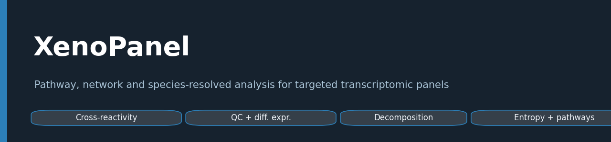
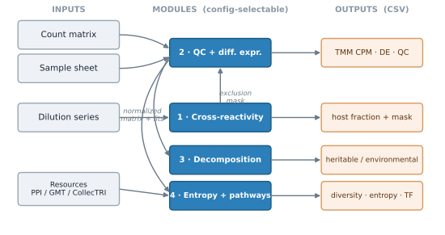
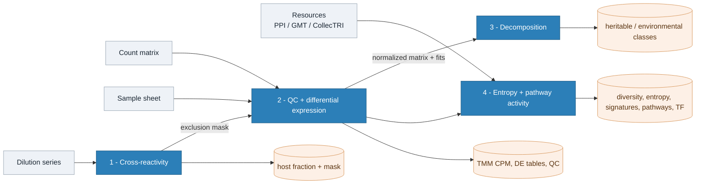
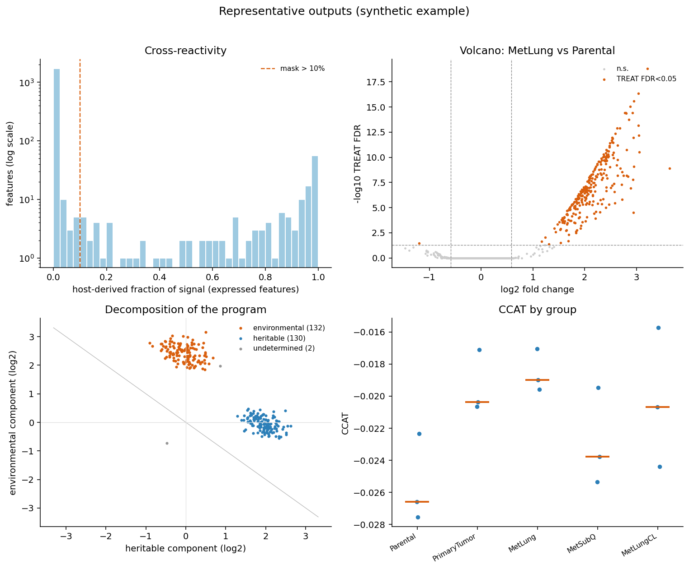

[](https://doi.org/10.5281/zenodo.23768221)

# XenoPanel

A configuration-driven pipeline for analysing targeted transcriptomic panel
data (DriverMap and comparable targeted RNA assays). It takes a count matrix
and a sample sheet in a documented format and runs four analysis modules that
can each be switched on or off:

1. **Cross-reactivity** — when a panel built for one species is applied to a
   mixed sample (for example a human tumour growing in a mouse), estimate the
   fraction of each feature's signal that comes from the second species, from
   a dilution series, and build an exclusion mask.
2. **QC + differential expression** — input validation, expression filtering
   (filterByExpr), TMM normalization, per-sample quality control, and
   differential expression by edgeR quasi-likelihood F-tests with TREAT,
   across any contrasts you define.
3. **Decomposition** — split each gene's change into a heritable component
   (retained when tissue is removed) and an environmental component (requiring
   tissue), using an exact additive identity over three states, with optional
   site attribution.
4. **Entropy + pathway activity** — transcriptome diversity (Shannon, Hill,
   N50, Gini), network entropy (SCENT signalling entropy rate and CCAT),
   signature scoring (singscore), PROGENy pathway activity, and CollecTRI
   transcription-factor activity.

Inputs, modules, thresholds and contrasts are all set in a YAML config; nothing
is hard-wired to one experiment. The analysis runs in R; an optional Python
layer loads results and draws plots. The repository contains code and a
synthetic example only — no research data.

## Workflow





The figure is regenerated by `python docs/make_workflow.py`.

## Example outputs

Representative results from the bundled synthetic example — host-signal masking,
differential expression, the heritable/environmental decomposition, and network
entropy by group. Regenerate with `python docs/make_example_montage.py`.



## Author

Spencer Winston Frangou (laboratory of Professor Jianmin Zhang)

Department of Cell and Cancer Biology
College of Medicine and Life Sciences, The University of Toledo
Health Science Campus, Mail Stop 1010
3000 Arlington Avenue
Toledo, OH 43614, USA

## License

MIT (see LICENSE).

## Quick start

```
# 1. generate the synthetic example data
Rscript examples/make_example_data.R

# 2. run the whole pipeline on it
Rscript run.R config.example.yaml

# 3. (optional) confirm the toolkit recovers the planted truth
Rscript tests/test_recovery.R
```

Outputs land in `examples/results/`. To run on your own data, copy
`config.example.yaml`, edit the paths, contrasts and thresholds, and run
`Rscript run.R your_config.yaml`.

See `docs/OVERVIEW.md` for the premise, the design and the methods the toolkit
builds on, `USAGE.md` for the full guide, `docs/INPUT_FORMAT.md` for the input
layout, `docs/REQUIREMENTS.md` for software and hardware, and
`docs/VALIDATION.md` for how the engine was checked.

## Plotting the results (optional Python layer)

Plotting lives in a small Python package under `python/`. It reads the
toolkit's CSV outputs and does not recompute anything.

```
pip install -r python/requirements.txt
python python/plot_results.py examples/results        # writes PNGs to examples/results/figures
```

Or from your own code:

```python
from xenopanel import Results, plots
res = Results("examples/results")
plots.volcano(res.de("MetLung_vs_Parental"))
plots.decomposition_scatter(res.decomposition())
```

## Scope

The R core performs the analysis and writes CSV tables; it draws no figures.
Plotting is the optional Python layer. This is the reusable analytical core,
not the figure pipeline of any one study.

## Citation

If you use XenoPanel, please cite the archived release:

> Frangou, S. W. (2026). *XenoPanel* (v1.0.0). Zenodo.
> https://doi.org/10.5281/zenodo.23768221

A machine-readable `CITATION.cff` is included, so GitHub's "Cite this
repository" button gives the same reference in APA and BibTeX.
